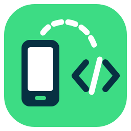
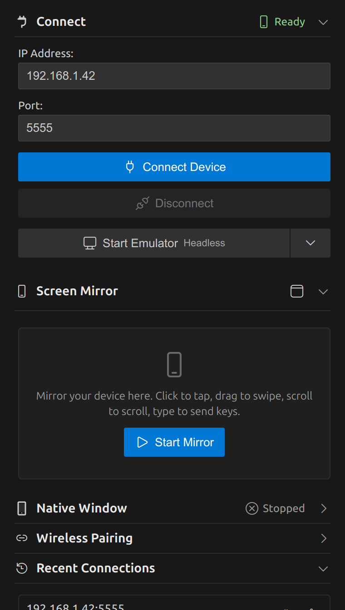
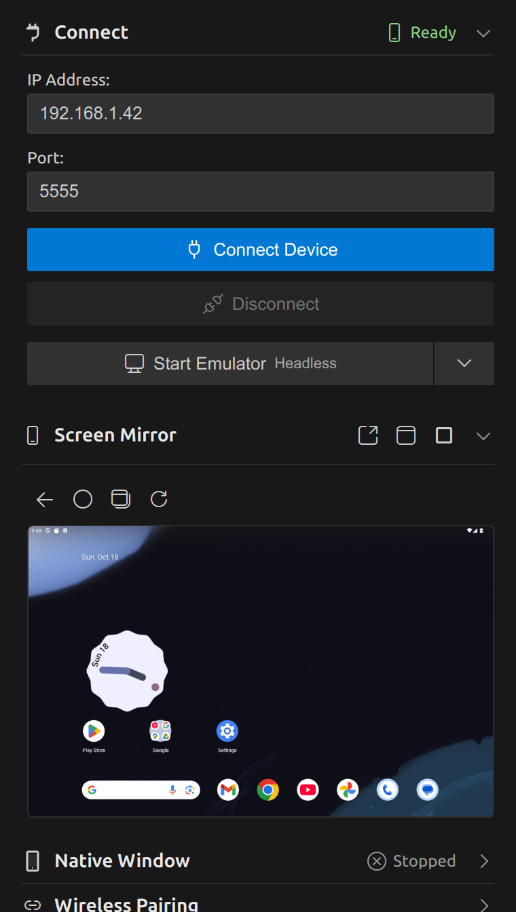
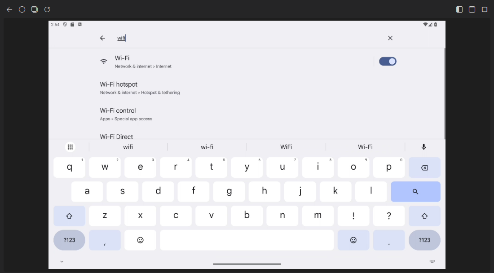

# DroidBridge

<div align="center">



**Seamlessly connect, control, and mirror Android devices inside VS Code**

[](https://marketplace.visualstudio.com/items?itemName=lusansapkota.droidbridge)
[](https://open-vsx.org/extension/lusansapkota/droidbridge)
[](https://open-vsx.org/extension/lusansapkota/droidbridge)
[](https://github.com/Lusan-sapkota/DroidBridge/releases)
[](https://code.visualstudio.com/)
[](https://github.com/Lusan-sapkota/DroidBridge/blob/main/LICENSE)
[](https://www.lusansapkota.com.np)

[Install](https://marketplace.visualstudio.com/items?itemName=lusansapkota.droidbridge) | [Documentation](https://lusan-sapkota.github.io/DroidBridge/) | [Issues](https://github.com/Lusan-sapkota/DroidBridge/issues) | [Portfolio](https://www.lusansapkota.com.np)

</div>

---

<p align="center">
  
  
</p>
<p align="center">
  
</p>

## Features

DroidBridge transforms your VS Code into a powerful Android development hub with these key features:

### **Wireless Device Management**
- **One-Click Connection**: Connect to Android devices over WiFi using IP address and port
- **Connection History**: Remember and quickly reconnect to recent devices
- **Smart Pairing**: Simplified pairing process for wireless debugging
- **Real-time Status**: Live connection status with detailed feedback

### **Live Screen Mirror Inside VS Code**
- **In the Sidebar**: The device screen streams live into the DroidBridge sidebar, no external window needed
- **Fully Interactive**: Click to tap, drag to swipe, scroll wheel to scroll, type to send text, right click for Back
- **Phones and Tablets**: Keeps the device aspect ratio at any sidebar width and follows rotation live
- **Pop Out**: Move the mirror into a resizable editor tab (or drag that tab into its own window), and back again
- **Device Controls**: Back, Home, Recent apps and Rotate buttons
- **Native Window Option**: Open the classic scrcpy window when you want it, with always-on-top
- **Nothing Extra to Install**: The scrcpy server is bundled; the embedded mirror only needs ADB

### **AI Agents Can Drive Your Device (MCP)**
- **Built-in MCP Server**: Lets AI agents see the screen, read the UI, tap, swipe, type, read logs and install apps
- **Works Everywhere**: Available to GitHub Copilot agent mode automatically, and to Claude Code, Cursor, Windsurf and other MCP clients with one copied command
- **Watch It Live**: Keep the mirror open while the agent works and see every step on the device

### **Smart Binary Management**
- **Auto-Detection**: Finds existing ADB/scrcpy installations automatically
- **Zero-Config Setup**: Downloads required binaries when not found
- **Cross-Platform**: Works seamlessly on Windows, macOS, and Linux
- **Custom Paths**: Support for custom binary locations

### **Native VS Code Integration**
- **Theme Adaptive**: Automatically matches VS Code's light/dark themes
- **Tidy Sidebar**: Collapsible sections that remember whether you opened or closed them
- **USB and Emulators**: Detects USB devices and emulators automatically, no IP needed
- **Command Palette**: Access all features via `Ctrl+Shift+P`
- **Comprehensive Logging**: Detailed logs for troubleshooting

## Quick Start

### Installation

#### **VS Code Marketplace** (Recommended)
```bash
# Search for "DroidBridge" in Extensions (Ctrl+Shift+X)
# Or install via command line
code --install-extension lusansapkota.droidbridge
```

#### **Manual Installation**
1. Download the latest `.vsix` from [Releases](https://github.com/Lusan-sapkota/DroidBridge/releases)
2. Install via: `Extensions > ... > Install from VSIX...`

### Setup Your Android Device

1. **Enable Developer Options**:
   ```
   Settings > About Phone > Tap "Build Number" 7 times
   ```

2. **Enable Wireless Debugging**:
   ```
   Settings > Developer Options > Enable "Wireless Debugging"
   ```

3. **Get Connection Details**:
   ```
   Developer Options > Wireless Debugging > Note IP:Port (e.g., 192.168.1.100:5555)
   ```

### Connect & Mirror

1. **Open DroidBridge**: Click the icon in VS Code's Activity Bar
2. **Connect Device**: Enter IP address and port, click "Connect Device"
3. **Start Mirroring**: Click "Start Mirror" in the Screen Mirror section (or the play button in the view title)
4. **Interact**: Click, drag, scroll and type on the mirror; use the toolbar for Back, Home, Recents and Rotate
5. **Pop Out**: Use the external link button to move the mirror into an editor tab, or the window button for a native scrcpy window

> **Pro Tip**: DroidBridge automatically handles ADB and scrcpy binaries - no manual installation needed!

## AI Agent Access (MCP)

DroidBridge ships an [MCP](https://modelcontextprotocol.io) server so AI agents can test and operate your app on a real device or emulator. Try prompts like *"Open my app, log in with the test account and tell me if the dashboard loads"* or *"Find out why the settings screen crashes; check logcat"*.

| Client | Setup |
|--------|-------|
| **GitHub Copilot (VS Code)** | Nothing to do. Open Chat in Agent mode and enable **DroidBridge Android** in the tools picker |
| **Claude Code** | Run **DroidBridge: Set Up AI Agent Access (MCP)**, choose Claude Code, paste the copied command in a terminal |
| **Cursor, Claude Desktop, Windsurf, others** | Run the same command, choose the JSON option, add it to the client's MCP config |

External clients need Node.js. The copied path stays valid across DroidBridge updates.

**Tools**

| Tool | What it does |
|------|--------------|
| `list_devices` | Connected devices and emulators |
| `screenshot` | Screen image (downscaled), with the scale to device pixels |
| `ui_tree` | On-screen elements with text, id, description and tap coordinates |
| `tap`, `long_press`, `swipe` | Touch input in device pixels |
| `tap_element` | Tap an element by text, resource id or description |
| `type_text`, `press_key` | Keyboard input (ASCII text; keys such as back, home, enter) |
| `current_app`, `list_apps`, `launch_app` | Inspect and start apps |
| `install_apk` | Install or update an APK from your computer |
| `logcat` | Recent logs, filtered by priority or text |
| `shell` | Run an `adb shell` command on the device |

With more than one device connected, tools take a `serial` argument (see `list_devices`). Agents act on your device as you would, so review what you allow them to run, especially `shell` and `install_apk`.

## Interface Overview

### Sidebar Sections

#### **Screen Mirror**
- **Live View**: Interactive device screen that resizes with the sidebar
- **Toolbar**: Back, Home, Recent apps, Rotate, open in editor tab, open native window, stop
- **Keyboard**: Click the mirror, then type; Enter, Backspace, arrows and Escape (Back) are supported

#### **Device Connection**
- **IP/Port Fields**: Pre-filled with your last successful connection
- **Connect/Disconnect**: One-click connection management
- **Status Display**: Connection state with helpful error messages

#### **Native Window**
- **Launch Scrcpy**: Open the device in a separate scrcpy window (requires scrcpy installed)
- **Launch Screen Off**: Mirror with device screen off (battery saving)
- **Stop Scrcpy**: Close the native window

#### **Connection History**
- **Recent Devices**: Quick access to your last 10 connections
- **One-Click Reconnect**: Click the plug icon to instantly reconnect
- **Manage History**: Remove unwanted entries with trash icon

#### **Wireless Pairing**
- **Manual Pairing**: Enter host, port, and 6-digit code from device
- **Quick Setup**: Streamlined pairing for first-time connections

### Command Palette

Access all features via `Ctrl+Shift+P` / `Cmd+Shift+P`:

```
DroidBridge: Connect to Device
DroidBridge: Disconnect Device
DroidBridge: Launch Scrcpy
DroidBridge: Launch Scrcpy Screen Off
DroidBridge: Stop Scrcpy
DroidBridge: Start Screen Mirror
DroidBridge: Stop Screen Mirror
DroidBridge: Open Screen Mirror in Editor Tab
DroidBridge: Open Screen Mirror in Native Window
DroidBridge: Set Up AI Agent Access (MCP)
DroidBridge: Show Logs
DroidBridge: Check Binary Status
DroidBridge: Download Missing Binaries
DroidBridge: Refresh Binary Detection
```

## Configuration

### VS Code Settings

Configure DroidBridge via `Settings` > `Extensions` > `DroidBridge`:

| Setting | Description | Default |
|---------|-------------|---------|
| `droidbridge.defaultIp` | Default IP address for connections | `"192.168.1.100"` |
| `droidbridge.defaultPort` | Default port for ADB connection | `"5555"` |
| `droidbridge.adbPath` | Custom ADB binary path (optional) | `""` |
| `droidbridge.scrcpyPath` | Custom scrcpy binary path (optional) | `""` |
| `droidbridge.scrcpy.maxSize` | Longest side of the mirror in pixels, `0` for native | `1024` |
| `droidbridge.scrcpy.bitrate` | Video bitrate, raise for high resolution tablets | `"8M"` |
| `droidbridge.scrcpy.alwaysOnTop` | Keep the mirror window above other windows | `true` |

### Configuration Examples

<details>
<summary><strong>Basic Setup</strong></summary>

```json
{
  "droidbridge.defaultIp": "192.168.1.150",
  "droidbridge.defaultPort": "5555"
}
```
</details>

<details>
<summary><strong>Custom Binary Paths</strong></summary>

```json
{
  "droidbridge.adbPath": "/usr/local/bin/adb",
  "droidbridge.scrcpyPath": "/usr/local/bin/scrcpy"
}
```
</details>

<details>
<summary><strong>Development Environment</strong></summary>

```json
{
  "droidbridge.defaultIp": "10.0.0.100",
  "droidbridge.defaultPort": "5037",
  "droidbridge.adbPath": "/Android/Sdk/platform-tools/adb",
  "droidbridge.scrcpyPath": "/usr/local/bin/scrcpy"
}
```
</details>

## Binary Management

DroidBridge features an intelligent binary management system that handles ADB and scrcpy automatically:

### Smart Detection Process

1. **Custom Paths**: Your configured binary locations
2. **System PATH**: Homebrew, apt, chocolatey installations  
3. **Common Directories**: Platform-specific standard locations
4. **Auto-Download**: Fetches latest binaries from [droidbridge-binaries](https://github.com/Lusan-sapkota/droidbridge-binaries)

### Management Commands

| Command | Description |
|---------|-------------|
| `Check Binary Status` | View current detection status for all binaries |
| `Download Missing Binaries` | Download any missing ADB/scrcpy binaries |
| `Refresh Binary Detection` | Re-scan system for existing installations |

### Supported Platforms

| Platform | ADB Source | Scrcpy Source |
|----------|-----------|---------------|
| **Windows** | Android SDK, Chocolatey, Manual | GitHub Releases, Chocolatey |
| **macOS** | Android SDK, Homebrew, Xcode | Homebrew, GitHub Releases |
| **Linux** | Android SDK, apt/yum/pacman | Package Manager, AppImage |

### Offline Usage

No internet? No problem:
1. Install binaries manually via package manager
2. Add them to your system PATH
3. Or configure custom paths in settings

> **Binary hosting**: All binaries are securely hosted at [github.com/Lusan-sapkota/droidbridge-binaries](https://github.com/Lusan-sapkota/droidbridge-binaries)

## Troubleshooting

<details>
<summary><strong>Connection Issues</strong></summary>

### Device Won't Connect
- Both device and computer on same WiFi network
- Wireless debugging enabled in Developer Options
- Correct IP address and port entered
- Try: `adb kill-server && adb start-server`

### "Device Offline" Error
- Disconnect and reconnect device
- Check network connectivity
- Restart wireless debugging on device
- Check firewall/VPN settings

</details>

<details>
<summary><strong>Screen Mirroring Issues</strong></summary>

### Scrcpy Won't Launch
- Device connected via ADB first
- USB debugging enabled
- Device authorization prompt accepted
- Test manually: `scrcpy --help`

### Poor Performance
- Lower resolution (max-size parameter)
- Reduce bitrate
- Close other device apps
- Check WiFi bandwidth

### Mirror Problems
- If the mirror freezes, stop and start it again from the toolbar
- Lower `droidbridge.scrcpy.maxSize` or the bitrate on slow Wi-Fi
- Taps not registering: click inside the device image, not the border
- For the native window, check that it is not hidden behind other windows

</details>

<details>
<summary><strong>Binary Issues</strong></summary>

### "Binary Not Found" Errors
1. Run `Check Binary Status` command
2. Use `Download Missing Binaries`
3. Manual installation:
   ```bash
   # Windows (Chocolatey)
   choco install adb scrcpy

   # macOS (Homebrew)  
   brew install android-platform-tools scrcpy

   # Linux (Ubuntu/Debian)
   sudo apt install adb scrcpy
   ```

### Download Failures
- Check internet connection
- Verify firewall/proxy settings
- Try `Refresh Binary Detection`
- Configure custom paths

</details>

<details>
<summary><strong>Getting Help</strong></summary>

1. **Check Logs**: `DroidBridge: Show Logs`
2. **Reset Settings**: Clear custom paths
3. **Restart Extension**: `Developer: Reload Window`
4. **Report Issues**: [GitHub Issues](https://github.com/Lusan-sapkota/DroidBridge/issues)

</details>

## Requirements

### System Requirements
| Component | Requirement |
|-----------|-------------|
| **VS Code** | 1.104.0+ |
| **OS** | Windows 10+ / macOS 10.14+ / Linux (Ubuntu 18.04+) |
| **Android** | 5.0+ with Developer Options |
| **Network** | Same WiFi network for device & computer (or USB) |

### Dependencies

DroidBridge automatically manages these essential tools:

<table>
<tr>
<td>

**ADB (Android Debug Bridge)**
- Device connection & communication
- Auto-downloaded if missing
- Custom paths configurable

</td>
<td>

**Scrcpy**
- High-performance screen mirroring
- Lightweight & efficient
- Optimized settings included

</td>
</tr>
</table>

> **Smart Binary Management**: Extension automatically detects, downloads, and configures all required tools. No manual setup needed!

## Known Issues

| Issue | Description | Workaround |
|-------|-------------|------------|
| **Multiple Instances** | Scrcpy instances may conflict | Stop existing sessions first |
| **Device Setup** | Some devices need extra wireless setup | Follow device-specific guides |
| **WiFi Latency** | Network can affect performance | Use 5GHz WiFi or USB debugging |
| **Windows Paths** | Custom binaries need `.exe` extension | Include full path with extension |

## Contributing

We welcome contributions! Help make DroidBridge even better.

### Quick Start
```bash
# 1. Fork the repository
git clone https://github.com/yourusername/DroidBridge.git

# 2. Install dependencies
npm install

# 3. Start development
npm run watch

# 4. Test your changes
npm test
```

### Contribution Guidelines
- Create feature branches from `main`
- Add tests for new functionality  
- Update documentation
- Follow existing code style
- Submit detailed pull requests

### Bug Reports
Found a bug? [Create an issue](https://github.com/Lusan-sapkota/DroidBridge/issues) with:
- Steps to reproduce
- Expected vs actual behavior
- Environment details (OS, VS Code version, etc.)

---

## About

**Created by [Lusan Sapkota](https://lusansapkota.com.np)**

DroidBridge combines modern Android development tools with VS Code's powerful interface, making device management effortless and productive.

- **Binaries Repository**: [DroidBridge-Binaries](https://github.com/Lusan-sapkota/DroidBridge-Binaries)
- **Portfolio**: [lusansapkota.com.np](https://lusansapkota.com.np)
- **Contact**: Available through GitHub or portfolio site

### Support This Project

If DroidBridge has improved your development workflow:
- Star this repository
- Report bugs and suggest features
- Contribute code or documentation
- Share with other developers

---

<div align="center">

**Made with for the Android development community**

[](https://code.visualstudio.com/)
[](https://developer.android.com/)

</div>

## License

This project is licensed under the MIT License - see the LICENSE file for details.

## Acknowledgments

- [scrcpy](https://github.com/Genymobile/scrcpy) - Screen mirroring; the scrcpy server (Apache-2.0) is bundled unmodified, see `resources/scrcpy-server.LICENSE`
- [Android Debug Bridge (ADB)](https://developer.android.com/studio/command-line/adb) - Android debugging tool
